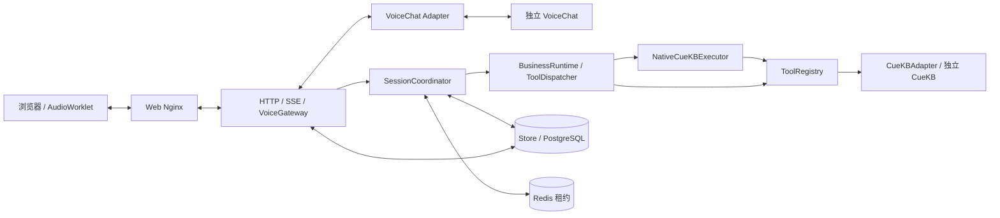

# 当前系统架构

2026-10-20 核对一期原生 relay、Provider、Coordinator、Runtime 与部署边界。本页维护已实现架构；改进方案见 [实施设计](q1003-target-architecture.md)，工作状态见 [任务板](TASK_BOARD.md)。

当前一期部署为 VoiceChat 原生单工具验证：只向模型注册 search_knowledge_base(query)，通过内部 NativeCueKBExecutor→Registry→CueKBAdapter 检索，直接回填精简证据，由 VoiceChat 生成语音。AGENT_PROVIDER=disabled，不运行额外答案模型；外置 SDK/文本模型路径仅保留兼容实现，不在下图的一期数据流中。原生工具选择、连续追问与实际口述验收见 [验证步骤](native-cuekb-validation.md)。

原生 relay 按连接/input_item_id 保存有界检索状态，默认最多两次实际查询、相同参数不重复执行；该路径关闭 HTTP 自动重试。重复查询或预算耗尽的结果标为 finished，之后再次调用报 VOICE_TOOL_LOOP 并关闭异常连接。Coordinator 将同一输入的累计有效证据用于回填、答案校验和引用提交；空的补充检索不丢失既有事实。缓存复用仍复核权限和后端版本，不跨输入共享。硬性查询上限不等于模型已成功回答，实际语音闭环仍须验收。

## 1. 产品与部署边界

当前系统仅支持英文全双工知识客服及连接内多轮对话，支持并行收音与播放；工具等待阶段的语音交互能力单独验证。当前为单组织、只读知识与每通话临时 capability。VoiceChat-11B + nemotron-labs-voicechat + WS 是独立语音系统，CueKB 是独立知识系统。本项目控制授权、任务、知识执行与交付，不训练模型、管理 GPU 或直连 CueKB 索引。语音输入、回答及门户交互仅支持英文；中文不属于本期产品能力。

语言约束有实际实现依据：[Settings](../apps/api/app/config.py) 的默认语言及要求语言、[ConversationInput](../apps/api/app/contracts.py) 的 locale 均限定为 `en-US`；VoiceGateway 拒绝其他语言会话；VoiceChat 注册提示和工具描述为英文；门户 HTML、组件库和新会话请求使用 `en-US`。中文协作文档、存储原文、旧日期别名和 Unicode 测试不改变该范围。当前 CueKB-only 路径不启用天气工具；保留的天气适配器也使用英文用户文案。配置和协议限制不等于模型已完成真实英文语音验收。

Python/FastAPI/Agents SDK 与 React/TypeScript/AudioWorklet；生产状态为 PostgreSQL，租约为 Redis。Web 镜像内 Nginx 提供 HTTPS，同源代理到 API。端口、参数、镜像和迁移只看 [部署](deployment.md)，字段与客户端行为只看 [门户协议](portal-protocol.md)。

## 2. 模块与数据流

图中 Runtime/Registry 表示代码调用边界，不是新增独立服务。无工具一般回答经过 Gateway/Store，不创建知识 Turn，也不调用 CueKB/外置模型。

VoiceChat 内部并非 ASR 文本驱动 LLM：16 kHz 音频经共享 encoder 分别进入辅助 RNNT 和语音语言主干；后者产生文本与 function 通道，文本再进入持续式 TTS。应用收到原生调用后绑定 final ASR 确定输入归属；一期以模型 query 结合可信上下文检索，不用转写替换 query。这解释了 ASR 错误会影响应用查询，却不能单凭丢字推出模型漏调用的原因。

| 代码模块 | 职责 | 修改时读 |
| --- | --- | --- |
| `api/auth.py`、`routes.py` | 通话归属/范围、HTTP/SSE/WS、受权历史、管理隔离 | 门户协议 / 接入 §6 |
| `voice/provider.py`、`gateway.py`、`relay.py` | 供应商事件归一化、连续收发、原生调用/结果回填、输入审计、背压 | 接入 §3 / 口述与交付 |
| `sessions/coordinator.py`、`coordination.py` | 唯一业务提交、幂等、epoch/revision、任务/租约、共享期限 | 本页 §3 / 上下文 / 交付 |
| `agent_runtime/` | 原生工具静态分派、直查或 SDK 推理、证据/呈现检查 | 知识执行 / 交付 §1 |
| `agent_runtime/tool_catalog.py` | 全局后台目录、可信实现映射、revision；语音连接冻结注册快照 | 工具目录 |
| `tools/registry.py`、`adapters.py`、`schemas.py` | 后台工具权限、版本、限时、上游契约与证据映射 | CueKB 契约 / 接入 §5 |
| `task_context.py`、`storage/`、`migrations/` | 来源条件、业务/交付/审计持久化、授权裁剪、迁移/留存 | 上下文 / 交付 §2 / 部署 |
| `apps/web/src/`、`public/` | 收音/重采样、消息合并、证据显示、独立响应播放/排空估计 | 门户协议 |

供应商原始事件仅在 voice 边界解释，Agents SDK 仅在 agent_runtime 使用。浏览器不持有供应商密钥、私有地址或执行工具的权限。

## 3. 一轮请求与状态边界

一期原生 CueKB/general_qa 会话使用 relay。其它目录和 knowledge_required/legacy 保留旧兼容路径；其发声许可和补偿机制不进入一期流程。

1. Start call 创建绑定 conversation/epoch/Origin 的一次性票据，建立一条 VoiceChat 连接并确认工具目录。
2. 持续转发输入音频与模型输出；普通问答、ACK、知识回复不消耗一次性发声许可。保留同一连接供多轮与指代追问。
3. 模型原生调用才触发业务。按原 call_id 幂等，校验工具/参数与权限，使用模型 query 查询 CueKB，原 call_id 回填必要证据。
4. Coordinator 唯一提交业务记录。检索有期限，模型续答不共用检索期限；连接结束或明确取消会结清等待观察的任务。
5. 回答文本/音频完成用于审计，来源检查不伪装为播前事实保证，也不阻断后续普通问答。Web 同时收音与播放；原生 speech_started 清除已排队播放，查询不中止。

| 状态层 | 权威对象 | 不能推导的结论 |
| --- | --- | --- |
| 用户输入/上下文 | Utterance、最终 ASR、带来源条件 | 一般回复不是企业证据；转写相似不代表同一轮 |
| 业务 | Turn、revision、epoch、当前租约 | accepted 不意味着网络成功或已听到 |
| 结果/音频交付 | DeliveryAttempt、response/call 关联、呈现检查 | 写入和数据库无共同事务；unknown 不重发 |
| 浏览器播放 | response 队列、samples、finished 估计 | audio.done 不等于队列排空；排空不等于用户听到 |

`parent_task_id` 表示前一轮任务，不是子 Agent。提交文字会结束当前语音，不定义文字与语音并行竞争。新 revision 替换旧业务；普通发声、附和、固定 ACK 或停止播放不能自行取消业务。支持等待修订的 Adapter 还必须安全结清旧 pending call，不能只丢弃本地结果；具体控制矩阵归门户/交付文档。

## 4. 权限、并发与故障

- 有效 KB 范围取服务端授权/部署范围/受限 CueKB Key 的交集。知识与历史均作为数据，不能执行其中指令或扩大权限；历史、SSE、后续模型上下文也复核撤权。细节归 [接入 §6](integration.md#6-独立通话与知识范围d02d13)。
- 所有网络方向保持有界队列，背压/失败显式终止；上游只有一个写入器。供应商须提供有序逐轮 response/结束边界，不能凭音量、字幕相似或任意延迟猜音频归属。匹配版本见 [补丁交付](../deploy/voicechat/README.md)。
- 丢弃过期业务结果后仍须结清原生调用或关旧连接。重连只恢复授权业务摘要，不恢复录音、播放队列或模型隐藏状态。轮换等待 quiet、无待写回工具及排空/抑制，仍受有限宽限期约束。
- Redis 租约与数据库版本共同隔离多副本，粘性路由和故障恢复要求归部署；取消本地 coroutine 不证明远端 HTTP/GPU 已停止。
- VoiceChat 失败可显式使用文字入口；CueKB/文本模型错误不得伪造事实或静默回退 mock。日志不记问题/音频/凭据正文。

## 5. 演进与验收入口

当前现场已证明工具名、原生调用与检索走通，但工具后完整回答仍需在新 relay 上验收。现有补丁撤回和 CPU 通过不能证明 GPU 已修复。按 [实施设计](q1003-target-architecture.md) 与 [单入口验证](native-cuekb-validation.md) 完成英文连续多轮、知识追问、实际听音和打断；hello 句首问题单独暂缓。
